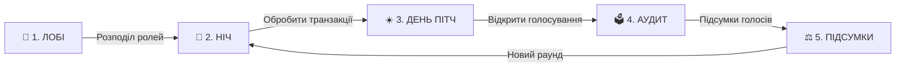

# 🌱 Кремнієва Долина: Битва Стартапів (Silicon Valley: Startup Battle)

[](https://www.python.org/)
[](https://flask.palletsprojects.com/)
[](https://socket.io/)
[](https://startup-battle-ua.onrender.com)
[]()
[]()

Інтерактивна браузерна онлайн-гра у форматі **«Фінансової Мафії»** для учнів 5–9 класів, створена спеціально до **Тижня фінансової грамотності**.

Учасники стають засновниками технологічних стартапів, керують капіталом у **🪙 Startup-Coins (SC)**, інвестують у захист свого бізнесу та намагаються викрити тіньовий картель рейдерів і шахраїв.

---

## 🌐 Демонстрація наживо (Live Demo)

Гра розгорнута і працює 24/7 у хмарі (без потреби тримати власний сервер):

* 📱 **Термінал учня:** [https://startup-battle-ua.onrender.com/play](https://startup-battle-ua.onrender.com/play)  
* 👩‍🏫 **Панель ведучого (Admin Desk):** [https://startup-battle-ua.onrender.com/admin](https://startup-battle-ua.onrender.com/admin)  
* 🖥️ **Екран для проєктора / Zoom / Google Meet:** [https://startup-battle-ua.onrender.com/display](https://startup-battle-ua.onrender.com/display)  
* 📖 **Картки ролей та шпаргалка для ведучого:** [https://startup-battle-ua.onrender.com/rules](https://startup-battle-ua.onrender.com/rules)  

---

## 🔥 Що нового (Changelog v2.0)

В оновленій версії реалізовано повноцінну підтримку масштабного використання гри кількома школами одночасно:

1. **🏫 Мульти-сесійний рушій (до 25 одночасних шкільних кімнат):**
   - Будь-який вчитель в Україні може відкрити `/admin` і в 1 клік отримати власну ізольовану кімнату з 4-значним PIN-кодом (наприклад, `#4821`).
   - До 25 різних класів можуть грати паралельно без перетину гравців, балансів чи раундів.
2. **🚫 Захист ліміту слотів (Capacity Guard):**
   - Якщо одночасно зайнято всі 25 кімнат, система показує зрозуміле інформаційне повідомлення із проханням зачекати або підключитися до вже існуючої сесії за її PIN-кодом.
   - Додано кнопку ручного вивільнення слота `🚪 Закрити сесію` та автоматичне очищення неактивних кімнат через 3 години.
3. **🤖 Розумні AI-боти з тактичним інтелектом:**
   - **Аудитор-бот:** має пам'ять перевірок (не перевіряє ту саму компанію двічі) та гарантовано голосує проти знайденого вночі шахрая.
   - **Рейдер та Інсайдер (боти):** синхронізують нічні удари по вразливих стартапах, не голосують проти своїх спільників на аудиті та підтримують тактичну розмову у чаті.
   - **Банкір-бот:** пріоритетно страхує стартапи під загрозою банкрутства (`<= 100 🪙 SC`).
4. **🕵️ Червоно-чорний дизайн Таємного Чату Картелю:**
   - Стилізація під зашифрований термінал (Obsidian & Crimson Red, контрастний текст, швидкі фрази).
5. **🌙 Динамічний Night Mode:**
   - Автоматичне перемикання всіх екранів на глибокий чорний фон із неоново-смарагдовим та золотим контрастним текстом у фазі `🌙 НІЧ` та повернення до світлої м'ятної теми вдень.
6. **📱 Живий QR-код із підстановкою PIN-коду кімнати:**
   - QR-код автоматично вшиває лінк з номером кімнати (`/play?room=XXXX`), дозволяючи учням входити за 1 секунду без ручного введення цифр.
7. **🛡️ Захист від повторних транзакцій та автовизначення переможця:**
   - Заблоковано випадкові подвійні списання при повторному натисканні кнопок обробки ночі або підсумків.
   - Автоматичне оголошення «Перемоги Чесного Ринку» з визначенням найбагатшого стартапу (MVP) або «Монополії Тіньового Картелю».

---

## 💡 Ключові особливості

- 🏫 **Multi-Room PIN Engine:** незалежна гра для різних класів та шкіл з автогенерацією кодів.
- ⚡ **Zero-DB & In-Memory State:** відсутність сторонніх баз даних, надшвидка робота в оперативній пам'яті сервера.
- 🔒 **Zero-Leakage Architecture:** жоден учень не може підглянути чужу роль через код сторінки чи WebSocket-трафік; екран `/display` безпечний для показу через проєктор.
- 🤖 **Гнучка комплектація ботами:** кнопки `+1 AI-Бот`, `+5 AI-Ботів` та `Прибрати ботів` дозволяють грати навіть невеликим групам (від 3 учнів).
- 🎙️ **Інтерактивний телесуфлер:** готові підказки та атмосферні фрази для ведучого на кожну фазу гри прямо в адмін-панелі.

---

## 🎭 Ролі у грі

| Роль | Команда | Нічна дія | Денна дія |
| :--- | :---: | :--- | :--- |
| 🌱 **Етичний Стартапер** | Чесний ринок | Відпочиває та вивчає фінансові поради (KYC, Cash Flow, диверсифікація). | Презентує свій Pitch, захищає стартап та голосує на аудиті. |
| 🏦 **Венчурний Банкір** | Чесний ринок | Видає страховий грант компанії, рятуючи її від втрати 100 🪙 SC у разі атаки. | Бере участь у публічних дебатах інвесторів. |
| 🔍 **Податковий Аудитор** | Чесний ринок | Проводить KYC-перевірку компанії та дізнається: «Легальний бізнес» чи «Тіньова схема». | Оприлюднює результати аудиту та спрямовує голосування. |
| 🏴‍☠️ **Рейдер / Шахрай** | Тіньовий картель | Атакує стартап із метою ворожого поглинання (-100 🪙 SC). | Маскується під чесний бізнес, відводить підозри на аудиті. |
| 🕵️ **Інсайдер Картелю** | Тіньовий картель | Координує цілі картелю у таємному чаті та вираховує Податкового Аудитора. | Створює коаліції голосів проти чесних засновників. |

---

## 🪙 Економічна модель

* **Стартовий капітал:** кожен засновник починає зі **100 🪙 Startup-Coins (SC)**.
* **Банкрутство:** якщо баланс компанії падає до **0 🪙 SC**, вона втрачає право голосу та нічних операцій.
* **Ранкові дивіденди (+10 🪙 SC):** базовий грошовий потік, який нараховується всім активним стартапам щоранку.
* **Бонус за прозорість (+20 🪙 SC):** виплата всім чесним бізнесам у разі викриття та ліквідації шахрая під час денного аудиту.

---

## 🔄 Цикл гри для ведучого



1. **Крок 1: ЛОБІ** — реєстрація учнів за PIN-кодом кімнати та роздача ролей кнопкою `⚖️ Авто-баланс`.
2. **Крок 2: НІЧ** — виконання таємних операцій (Рейдери атакують, Банкір страхує, Аудитор перевіряє).
3. **Крок 3: ДЕНЬ (ПІТЧИНГ)** — ранкові новини біржі, 30-секундні пітчі засновників та виплата дивідендів (+10 🪙 SC).
4. **Крок 4: АУДИТ** — загальне голосування ради директорів проти підозрілих компаній.
5. **Крок 5: ПІДСУМКИ** — підрахунок голосів, ліквідація підозрюваного та нарахування премії за шахрая (+20 🪙 SC).
6. **Перехід у наступний раунд:** ведучий знову натискає `Крок 2: НІЧ` — номер раунду автоматично збільшується, а старі голоси скидаються.

---

## 🚀 Локальний запуск (альтернатива хмарі)

### Через готовий батник (Windows):
Просто двічі клікніть на файл:
```cmd
start_game.bat
```
Він автоматично перевірить наявність бібліотек, підніме локальний сервер та запустить `ngrok`-тунель за наявності.

### Через термінал:
```bash
# 1. Клонувати репозиторій
git clone https://github.com/dark1604/finmafia.git
cd finmafia

# 2. Встановити залежності
pip install -r requirements.txt

# 3. Запустити сервер
python app.py
```

---

## 🛠️ Стек технологій

* **Backend:** Python 3.10+, Flask, Flask-SocketIO, Simple-WebSocket, Gunicorn
* **Frontend:** Modern Vanilla JavaScript (ES6+), HTML5, CSS3 (Glassmorphism, Dark/Light Transitions)
* **Real-Time:** WebSockets (Socket.IO bi-directional events)
* **Deployment:** Render.com (Linux Web Service)

---

## 📄 Ліцензія

Розроблено для освітніх цілей у межах **Тижня фінансової грамотності**. Проєкт відкритий для некомерційного використання у школах, ліцеях, гімназіях та освітніх хабах.
