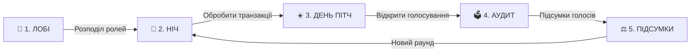

# 🌱 Кремнієва Долина: Битва Стартапів (Silicon Valley: Startup Battle)

[](https://www.python.org/)
[](https://flask.palletsprojects.com/)
[](https://socket.io/)
[](https://startup-battle-ua.onrender.com)
[]()

Інтерактивна браузерна онлайн-гра у форматі **«Фінансової Мафії»** для учнів 5–9 класів, створена спеціально до **Тижня фінансової грамотності**.

Учасники стають засновниками технологічних стартапів, керують капіталом у **🪙 Startup-Coins (SC)**, інвестують у захист свого бізнесу та намагаються викрити тіньовий картель рейдерів і шахраїв.

---

## 🌐 Демонстрація наживо (Live Demo)

Гра вже розгорнута і працює 24/7 у хмарі:

* 📱 **Термінал учня:** [https://startup-battle-ua.onrender.com/play](https://startup-battle-ua.onrender.com/play)  
* 👩‍🏫 **Панель ведучого (Admin Desk):** [https://startup-battle-ua.onrender.com/admin](https://startup-battle-ua.onrender.com/admin)  
* 🖥️ **Екран для проєктора / Zoom / Google Meet:** [https://startup-battle-ua.onrender.com/display](https://startup-battle-ua.onrender.com/display)  
* 📖 **Картки ролей та шпаргалка для ведучого:** [https://startup-battle-ua.onrender.com/rules](https://startup-battle-ua.onrender.com/rules)  

---

## 💡 Ключові особливості

- 🏫 **До 25 одночасних шкільних сесій (Multi-Room PIN Engine):** кожен вчитель при вході в `/admin` автоматично отримує ізольовану кімнату з унікальним 4-значним PIN-кодом (наприклад, `#4821`), що вшивається у QR-код. До 25 різних класів можуть грати одночасно без перетину даних.
- ⚡ **Zero-DB & In-Memory State:** гра не потребує зовнішніх баз даних; стан сесії, гравці, транзакції та голоси обробляються миттєво в оперативній пам'яті сервера (з автоматичним очищенням неактивних кімнат).
- 🔒 **Повна відсутність витоку даних (Zero-Leakage):** кожен екран отримує строго відфільтровані дані через приватні WebSocket-кімнати (учні не бачать чужих ролей, а публічний екран безпечний для демонстрації).
- 🤖 **Розумні AI-боти:** вбудований штучний інтелект дозволяє грати навіть малим складом або протестувати гру наодинці (боти вміють аналізувати ризики, страхувати стартапи, вести розслідування та писати в таємний чат).
- 🕵️ **Зашифрований Чат Картелю:** окремий захищений нічний канал зв'язку для Рейдера та Інсайдера у стилі кіберпанк (червоно-чорна неонова тема).
- 🌙 **Динамічний Night Mode:** інтерфейс автоматично перемикається у висококонтрастну чорну тему під час нічної сесії та повертається до свіжої м'ятної теми вдень.
- 📱 **QR-код для швидкого входу:** автоматичне генерування QR-коду на екрані біржі для миттєвого підключення зі смартфонів.

---

## 🎭 Ролі у грі

| Роль | Команда | Нічна дія | Денна дія |
| :--- | :---: | :--- | :--- |
| 🌱 **Етичний Стартапер** | Чесний ринок | Відпочиває та вивчає фінансові поради (KYC, Cash Flow, диверсифікація). | Презентує свій Pitch, захищає стартап та голосує на аудиті. |
| 🏦 **Венчурний Банкір** | Чесний ринок | Видає страховий грант компанії, рятуючи її від втрати 100 🪙 SC у разі атаки. | Бере участь у публічних дебатах інвесторів. |
| 🔍 **Податковий Аудитор** | Чесний ринок | Проводить KYC-перевірку компанії та дізнається: «Легальний бізнес» чи «Тіньова схема». | Оприлюднює результати аудиту та спрямовує голосування. |
| 🏴‍☠️ **Рейдер / Шахрай** | Тіньовий картель | Атакує стартап із метою ворожого поглинання (-100 🪙 SC). | Маскується під чесний бізнес, відводить підозри на аудиті. |
| 🕵️ **Інсайдер Картелю** | Тіньовий картель | Координує цілі картелю у таємному чаті та вираховує Податкового Аудитора. | Створює коаліції голосів проти чесних засновників. |

---

## 🪙 Економічна модель

* **Стартовий капітал:** кожен засновник починає зі **100 🪙 Startup-Coins (SC)**.
* **Банкрутство:** якщо баланс компанії падає до **0 🪙 SC**, вона втрачає право голосу та нічних операцій.
* **Ранкові дивіденди (+10 🪙 SC):** базовий грошовий потік, який нараховується всім активним стартапам щоранку.
* **Бонус за прозорість (+20 🪙 SC):** виплата всім чесним бізнесам у разі викриття та ліквідації шахрая під час денного аудиту.

---

## 🔄 Цикл гри для ведучого



1. **Крок 1: ЛОБІ** — реєстрація учнів та одноклікова роздача ролей.
2. **Крок 2: НІЧ** — виконання таємних операцій (Рейдери атакують, Банкір страхує, Аудитор перевіряє).
3. **Крок 3: ДЕНЬ (ПІТЧИНГ)** — ранкові новини біржі, 30-секундні пітчі засновників та нарахування дивідендів (+10 🪙 SC).
4. **Крок 4: АУДИТ** — загальне голосування проти компанії, підозрюваної у шахрайстві.
5. **Крок 5: ПІДСУМКИ** — ліквідація підозрюваного, виплата премії (+20 🪙 SC) або оголошення фінальної перемоги.

---

## 🚀 Локальний запуск

### Варіант А: Через готовий батник (Windows)
Просто двічі клікніть на файл:
```cmd
start_game.bat
```
Він автоматично перевірить наявність бібліотек, підніме локальний сервер та за наявності `ngrok` запустить тунель.

### Варіант Б: Вручну через термінал
```bash
# 1. Клонувати репозиторій
git clone https://github.com/dark1604/finmafia.git
cd finmafia

# 2. Встановити залежності
pip install -r requirements.txt

# 3. Запустити сервер
python app.py
```
Сервер буде доступний за адресою: `http://localhost:5000/admin`.

---

## 🛠️ Стек технологій

* **Backend:** Python 3.10+, Flask, Flask-SocketIO, Simple-WebSocket, Gunicorn
* **Frontend:** Modern Vanilla JavaScript (ES6+), HTML5, CSS3 (Glassmorphism, Flexbox/Grid, Dark/Light theme transitions)
* **Real-Time Engine:** WebSockets через Socket.IO (бідирекційна синхронізація з затримкою < 50ms)
* **Cloud Hosting:** Render.com (Linux Web Service)

---

## 📄 Ліцензія

Розроблено для освітніх цілей у межах **Тижня фінансової грамотності**. Проєкт відкритий для некомерційного використання у школах, гімназіях та освітніх хабах.
